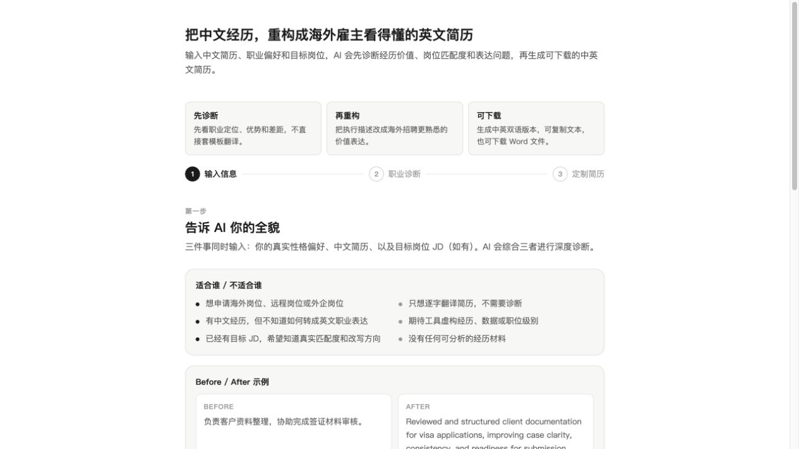

# 中文经历 → 英文简历

**先把自己做过的事讲清楚，再组织成海外招聘者能看懂的英文经历。**

一个带网页界面的 Cloudflare Worker：输入中文经历，探索职业方向，再围绕选定方向生成英文简历内容。支持编辑、复制和 Word 格式导出。

## 界面演示

输入页演示，没有填写真实简历或配置 API。



## 为什么做这个

很多经历本身有价值，困难在于如何解释：中文工作描述直译之后，容易只剩职责列表，看不出做了什么、为什么做、产生了什么结果。这个工具先帮助梳理事实，再按目标方向重组表达，减少在聊天工具里反复改提示词的操作。

它适合把已有经历写清楚，不适合生成自己没有做过的项目、资历或成绩。没有数字时不要让模型编一个数字。

## 使用流程

1. 输入已脱敏的中文工作经历和补充信息。
2. 生成并比较职业方向，选择要继续的方向。
3. 检查英文内容是否忠于事实，再编辑、复制或导出。

导出的 `.doc` 是 Word 可打开的 HTML 文档，不是原生 DOCX；排版依 Office 版本而异。模型有可能截断、遗漏或误判经历，需要人工核对。

## 在自己的电脑上运行

需要 Node.js 22 或以上及 npm：

```sh
npm ci
cp .dev.vars.example .dev.vars
```

在本机 `.dev.vars` 填写自己的 `DASHSCOPE_API_KEY` 和至少 32 个字符的随机 `ACCESS_TOKEN`。可用 `openssl rand -hex 32` 生成访问口令，勿粘贴到 GitHub。再将 `wrangler.jsonc` 的 `MODEL` 改为自己账号支持的模型名称。

```sh
npm run dev
```

打开启动输出的本地 URL。生成时输入服务访问口令；**网页不要求填写模型 API Key**。访问口令只保存在当前标签页内存，刷新后需重输；它同样是凭证，请勿分享。

## 自行部署

用户自行申请 Cloudflare 和模型服务账号，承担调用费用。模型密钥放服务器端 Secret：

```sh
npx wrangler secret put DASHSCOPE_API_KEY
npx wrangler secret put ACCESS_TOKEN
npm run deploy
```

本地配置与 Secret 用法参考 [Cloudflare 官方文档](https://developers.cloudflare.com/workers/configuration/secrets/)。本仓库不包含作者密钥、个人 Worker 地址或云端部署 ID。

## 风险与已加的限制

- 简历输入会发送到自己的 DashScope 模型接口；本程序没有数据库保存简历，但平台、浏览器及模型提供者仍可能按其设置处理数据。提交前删除身份证号、住址、完整电话和保密业务信息。
- API 必须配置密钥和访问口令；跨来源请求拒绝，输入有大小限制，模型由服务器指定，每次生成最多 6000 tokens。原始上游错误不返回浏览器。
- 访问口令保护不等于完整的账户系统、限流或费用控制。公开部署还应配置平台限流和预算告警；知道口令的人可消耗你的额度。默认没有对公众开放免费调用。
- 模型输出应核对事实、措辞和岗位适配；本工具不承诺招聘结果。

## 配套 Skill、许可与联系

[resume-fact-editor](skills/resume-fact-editor/SKILL.md) 可帮助先梳理中文事实、标出待确认信息，再改写英文。它不会自行上传私人简历，也不提供 API。

原创代码使用 MIT；第三方依赖遵循各自许可。作者 [shane-lin67](https://github.com/shane-lin67)，反馈请到 [Issues](https://github.com/shane-lin67/english-resume-rewriter/issues)，示例请用虚构姓名与已脱敏经历。
